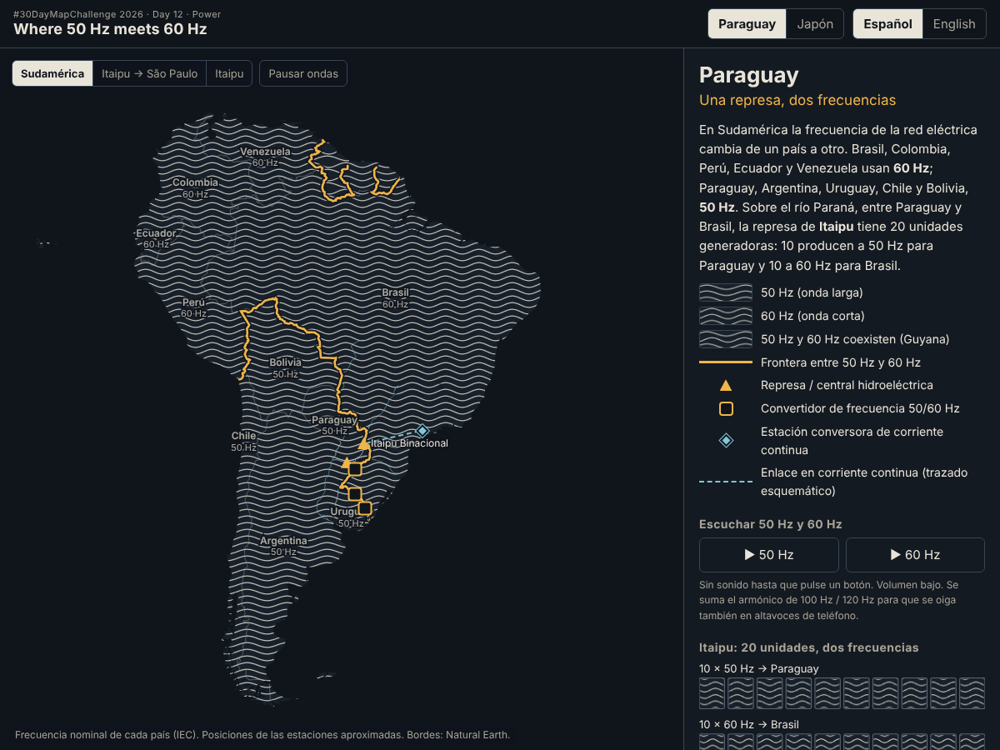
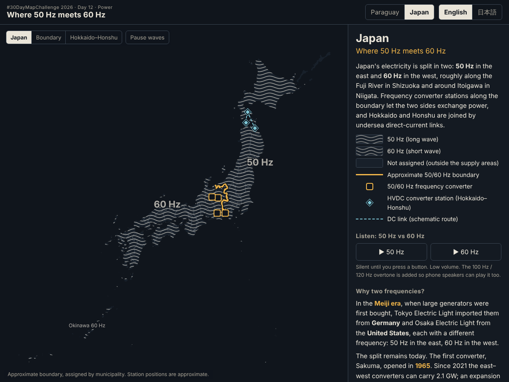

# Where 50 Hz meets 60 Hz

#30DayMapChallenge 2026 · Day 12 · Power (12 November 2026)

- Paraguay: https://shinyanakashima.github.io/30daymapchallenge-2026day12-50Hz60Hz/?view=py&lang=es
- Japan: https://shinyanakashima.github.io/30daymapchallenge-2026day12-50Hz60Hz/?view=jp&lang=en




## About

**English** — Mains electricity runs at 50 Hz in some places and 60 Hz in others. This map shows two places where the two meet. In South America the frequency changes at national borders: Brazil, Colombia, Peru, Ecuador and Venezuela use 60 Hz; Paraguay, Argentina, Uruguay, Chile and Bolivia use 50 Hz. On the Paraná River, the Itaipu dam generates with 20 units: 10 at 50 Hz for Paraguay and 10 at 60 Hz for Brazil. In Japan, the east is 50 Hz and the west 60 Hz, a split that goes back to generators imported from Germany (Tokyo) and the United States (Osaka) in the Meiji era. Converter stations sit along the boundary, and Hokkaido and Honshu are linked by undersea DC lines. Areas are drawn as waves rather than colours: long waves for 50 Hz, short waves for 60 Hz.

**Español** — La electricidad funciona a 50 Hz en unos lugares y a 60 Hz en otros. Este mapa muestra dos lugares donde se encuentran. En Sudamérica la frecuencia cambia en las fronteras: Brasil, Colombia, Perú, Ecuador y Venezuela usan 60 Hz; Paraguay, Argentina, Uruguay, Chile y Bolivia, 50 Hz. Sobre el río Paraná, la represa de Itaipu genera con 20 unidades: 10 a 50 Hz para Paraguay y 10 a 60 Hz para Brasil. En Japón, el este usa 50 Hz y el oeste 60 Hz, por los generadores que Tokio importó de Alemania y Osaka de Estados Unidos en la era Meiji. Las áreas se dibujan con ondas en lugar de colores: onda larga para 50 Hz y corta para 60 Hz.

**日本語** — 電気の周波数は、地域によって 50Hz と 60Hz に分かれています。この地図は、その二つが出会う場所を二つの地域で見せます。南米では国ごとに周波数が異なり、ブラジル、コロンビア、ペルー、エクアドル、ベネズエラは 60Hz、パラグアイ、アルゼンチン、ウルグアイ、チリ、ボリビアは 50Hz です。パラナ川のイタイプ・ダムでは、20基の発電機のうち10基がパラグアイ向けの 50Hz、10基がブラジル向けの 60Hz で発電しています。日本では東日本が 50Hz、西日本が 60Hz で、明治時代に東京がドイツから、大阪がアメリカから発電機を輸入したことに始まります。境目には周波数変換所が並び、北海道と本州は海底の直流送電線でつながっています。地図の塗りは色ではなく波線で表し、50Hz は長い波、60Hz は短い波です。

## How to use

- Switch between **Paraguay** and **Japan** at the top. Languages: Paraguay — Español / English; Japan — English / 日本語. When the current language is not available in the other view, English is used.
- URL parameters: `?view=py|jp&lang=es|en|ja`.
- Zoom buttons (South America → Itaipu; Japan → boundary / Hokkaido–Honshu), mouse wheel or pinch to zoom, drag to pan.
- Click a marker for name, capacity, year and role.
- The **50 Hz / 60 Hz** buttons play a tone (Web Audio, off until pressed, low volume) with its 100 Hz / 120 Hz overtone so phone speakers can play it.
- Waves move slowly (wavelength ratio 60:50, speed ratio 50:60). They stop when the device asks for reduced motion, and can be paused.

## Notes

- **Frequencies are nominal (standard) values for each country.** IEC lists Guyana as 60 Hz, but Guyana Power & Light states that it supplies both 50 and 60 cycle power, so Guyana is drawn with both waves.
- **The Japanese boundary is approximate.** Each municipality (wards for designated cities) was assigned 50 Hz or 60 Hz; 1,899 units: 859 at 50 Hz, 1,040 at 60 Hz. Where a municipality is split, it is assigned to the side covering most of it. Exceptions:
  - 静岡県富士市: shown 50 Hz; 旧富士川町 (west of the Fuji River) is 60 Hz.
  - 静岡県富士宮市: shown 50 Hz; 内房 (旧芝川町) is 60 Hz.
  - 新潟県糸魚川市・妙高市: shown 50 Hz; parts are supplied at 60 Hz.
  - 長野県: shown 60 Hz; some districts of 栄村, 野沢温泉村, 飯山市, 小諸市, 佐久市, 松本市, 安曇野市（穂高）, 大町市（平）and 小谷村 are supplied at 50 Hz.
  - 新潟県佐渡市 is 60 Hz and shown as such.
  - The six villages of the Northern Territories (N03 codes 01695–01700) are outside the supply areas of Japanese power companies and are not assigned.
- Positions of stations are approximate; DC routes are drawn as straight, schematic lines.
- The map presents technical facts only. It does not assess treaties, tariffs or energy trade.

## Data

| Data | Source | Accessed |
|---|---|---|
| Country borders, rivers, lakes (South America) | [Natural Earth](https://www.naturalearthdata.com/) 1:10m admin 0 countries, rivers + lake centerlines, lakes (public domain) | 2026-11-06 |
| Japanese municipalities | [国土数値情報（行政区域）N03](https://nlftp.mlit.go.jp/ksj/gml/datalist/KsjTmplt-N03-2026.html), 2026年1月1日時点（加工して作成） | 2026-11-06 |
| Country frequencies | [IEC World Plugs](https://www.iec.ch/world-plugs); Guyana: [GPL](https://gplinc.com/about-us/who-we-are/), [Technical Standards Regulations 2008](http://electricity.gov.gy/HECI_Docs/Publications/Final_Technical_Regulations-April%202008.pdf) | 2026-11-06 |
| Itaipu (units, 50/60 Hz split, 14,000 MW, 1984 / 2007, transmission) | Itaipu Binacional: [Perguntas frequentes](https://www.itaipu.gov.br/contatos/perguntas-frequentes), [Casa de Força](https://www.itaipu.gov.br/energia/geracao/casa-de-forca), [Nossa História](https://www.itaipu.gov.br/institucional/sobre-itaipu/nossa-historia) | 2026-11-06 |
| Foz do Iguaçu – Ibiúna DC link (±600 kV, 6,300 MW, 1984 / 1987) | [Eletrobras](https://eletrobras.com/pt/Paginas/Noticia.aspx?ID=1374), [EPE/ONS (2020)](https://www.epe.gov.br/sites-pt/publicacoes-dados-abertos/publicacoes/PublicacoesArquivos/publicacao-276/topico-525/NT(EPE-ONS)-Moderniza%C3%A7%C3%A3o%20Itaipu-CCAT.pdf) | 2026-11-06 |
| Yacyretá | EBY: [Central Hidroeléctrica](https://www.eby.gov.py/central-hidroelectrica-eby/), [30 años](https://www.eby.gov.py/30-anos-generando-energia-sin-descanso-para-el-desarrollo-del-pueblo-paraguayo/) | 2026-11-06 |
| Acaray | [ANDE](https://www.ande.gov.py/documentos/CH-ACARAY-WEB.pdf); converter: [EPE (2018)](https://www.epe.gov.br/sites-pt/publicacoes-dados-abertos/publicacoes/PublicacoesArquivos/publicacao-227/topico-457/Integracao%20Energetica%20Regional.pdf) | 2026-11-06 |
| Garabi, Rivera, Melo converters | [ONS (2021)](https://www.ons.org.br/AcervoDigitalDocumentosEPublicacoes/Relat%C3%B3rio%20de%20Intercambio%20Internacional_05%2021.pdf), [EPE (2018)](https://www.epe.gov.br/sites-pt/publicacoes-dados-abertos/publicacoes/PublicacoesArquivos/publicacao-227/topico-457/Integracao%20Energetica%20Regional.pdf) | 2026-11-06 |
| Japanese supply areas and frequencies | [東京電力パワーグリッド 託送供給等約款](https://www4.tepco.co.jp/pg/consignment/notification/pdf/henkou20260213.pdf), [中部電力ミライズ 周波数](https://miraiz.chuden.co.jp/home/electric/contract/structure/frequency/), [中部電力パワーグリッド 事業場一覧](https://powergrid.chuden.co.jp/goannai/ippan/denchu/kyouga/office/), [東北電力ネットワーク 低圧系統業務指針](https://nw.tohoku-epco.co.jp/consignment/system/rule/pdf/rule004.pdf), [北陸電力送配電](https://www.rikuden.co.jp/nw_qa/hz.html), [北海道電力ネットワーク](https://www.hepco.co.jp/network/con_service/stipulation/pdf/sp_frequency_adjust.pdf), [沖縄電力](https://www.okiden.co.jp/shared/pdf/business/free/fd_221227_01.pdf) | 2026-11-06 |
| Frequency converters | [J-POWER 歴史](https://www.jpower.co.jp/company_info/history/), [J-POWER送変電](https://www.jpower.co.jp/tn/business/about.html), [中部電力パワーグリッド（飛騨信濃）](https://powergrid.chuden.co.jp/news/press/1206089_3281.html), [中部電力（東清水）](https://www.chuden.co.jp/publicity/press/3210032_6926.html), [電気事業連合会](https://www.fepc.or.jp/enelog/cover/vol_40.html), [OCCTO 第101回広域系統整備委員会](https://www.occto.or.jp/assets/iinkai/kouikikeitouseibi/101/seibi_101_01_01.pdf) | 2026-11-06 |
| Hokkaido–Honshu links | [J-POWER](https://www.jpower.co.jp/news/2012/07/news120719.html), [北海道電力（2019）](https://www.hepco.co.jp/info/2018/1238121_1753.html), [OCCTO 第90回](https://www.occto.or.jp/assets/iinkai/kouikikeitouseibi/2025/files/seibi_90_02_01.pdf) | 2026-11-06 |
| Origin of 50/60 Hz in Japan | [中部電力](https://www.chuden.co.jp/energy/ene_about/electric/kids_denki/okuru/chichu/), [電気事業連合会](https://www.fepc.or.jp/enelog/cover/vol_40.html) | 2026-11-06 |

### Building the data

```sh
npm install
npm run build:data   # downloads Natural Earth and N03, writes data/*.topo.json
```

`scripts/build-data.sh` uses [mapshaper](https://github.com/mbloch/mapshaper):

1. South America: Natural Earth countries (French Guiana clipped from France), frequency joined from `scripts/hz-south-america.csv`; a simplified continental file and a more detailed file for the Itaipu region.
2. Japan: N03 polygons simplified (120 m) and dissolved by municipality code; `scripts/assign-japan.mjs` assigns 50 / 60 Hz from `scripts/hz-japan.csv` (prefecture defaults, then municipality overrides). The 50 Hz / 60 Hz areas and the boundary line are derived in the browser with topojson.

### Checking

```sh
npm run check   # Playwright: every view × language at 1200×900 and 390×844, console errors, 404s; writes docs/screenshot*.png
```

## License

Code: MIT. Map data: Natural Earth (public domain); 国土数値情報（行政区域）国土交通省（加工して作成）.
